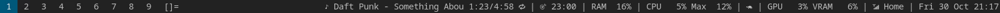

# dwm-status

A status bar script for dwm.



## Entries

| Name | Example | Notes |
|---|---|---|
| `music` | `♪ Daft Punk - Digital Love 1:23/5:01 🔁` | From [music-menu](https://github.com/sw1jari/music-menu), else Spotify via playerctl |
| `focus` | `🎯 13:00` or `☕ 14:00` | End of the focus block, or start of the next during a break, from [focus](https://github.com/sw1jari/focus) |
| `ram` | `RAM 16%` | |
| `cpu` | `CPU 5% Max 9%` | Average and the busiest core |
| `governor` | 🐢 or 🚀 | Powersave or performance |
| `gpu` | `GPU 3% VRAM 5%` | Only with nvidia-smi |
| `battery` | `🔋 80%` | ⚡ charging, 🔌 full, notifications at 10% and 5% |
| `network` | `📶 Home` or `🌐 eth` | |
| `date` | `Fri 30 Oct 21:06` | |

Music details:
- Titles longer than 26 characters scroll like a ticker.
- 🔁 means repeat all, 🔂 repeat one (Spotify only).
- Music paused for 10 minutes disappears until it plays again.

## Configuration

Settings go in `~/.config/dwm-status/config`, a bash file read at startup. Everything in it is optional. Restart dwm-status after changing it.

**Turn entries on or off, or reorder them** by listing them left to right. Leave one out to hide it.

```bash
# default
ENTRIES=(music focus ram cpu governor gpu battery network date)

# no GPU or governor, date first
ENTRIES=(date music focus ram cpu battery network)
```

**Add your own entry** with a function called `entry_<name>` that prints its text, and put the name in `ENTRIES`. It runs once a second, and an empty result hides the entry.

```bash
# disk use of /
entry_disk() {
    df --output=pcent / | tail -1 | tr -d ' ' | sed 's/^/💾 /'
}

# volume of the default output
entry_volume() {
    echo "🔊 $(pamixer --get-volume)%"
}

ENTRIES=(music focus disk volume ram cpu network date)
```

**Change the music settings:**

| Variable | Default | What it does |
|---|---|---|
| `MUSIC_WIDTH` | `26` | Characters before a title scrolls |
| `PAUSED_HIDE_SECONDS` | `600` | How long paused music stays on the bar |

## Install

Needs bash, xsetroot, procps (`free`) and NetworkManager (`nmcli`). Optional: nvidia-smi, playerctl, and dunst or libnotify for the battery notifications.

```sh
cp dwm-status ~/.local/bin/
```

Start it from `~/.xinitrc` before dwm:

```sh
dwm-status &
exec dwm
```

## License

MIT
