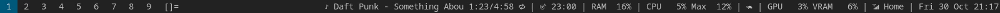

# dwm-status

A status bar script for dwm.



## Entries

| Name | Example | Notes |
|---|---|---|
| `music` | `♪ Daft Punk - Digital Love 1:23/5:01 🔁` | From [musicmenu](https://github.com/sw1jari/musicmenu), else Spotify via playerctl |
| `focus` | `🎯 13:00` or `☕ 14:00` | End of the focus block, or start of the next during a break, from [focus](https://github.com/sw1jari/focus) |
| `ram` | `RAM 16%` | |
| `cpu` | `CPU 5% Max 9%` | Average and the busiest core |
| `governor` | 🐢 or 🚀 | Powersave or performance |
| `gpu` | `GPU 3% VRAM 5%` | Only with nvidia-smi |
| `battery` | `🔋 80%` | ⚡ charging, 🔌 full, notifications at 10% and 5% |
| `network` | `📶 Home` or `🌐 eth` | |
| `vpn` | `eduVPN` | Name of the active NetworkManager VPN, `eduVPN...` while connecting, hidden when off |
| `date` | `Fri 30 Oct 21:06` | |

Music details:
- Titles longer than 26 characters scroll like a ticker.
- 🔁 means repeat all, 🔂 repeat one (Spotify only).
- Music paused for 10 minutes disappears until it plays again.

## Configuration

Settings go in `~/.config/dwm-status/config`, a bash file read at startup. Everything in it is optional. Restart dwm-status after changing it.

**Turn entries on or off, or reorder them** by listing them left to right. Leave one out to hide it.

```bash
# default
ENTRIES=(music focus ram cpu governor gpu battery network vpn date)

# no GPU or governor, date first
ENTRIES=(date music focus ram cpu battery network)
```

**Add your own entry** with a function called `entry_<name>` that prints its text, and put the name in `ENTRIES`. It runs once a second, and an empty result hides the entry.

```bash
# disk use of /
entry_disk() {
    df --output=pcent / | tail -1 | tr -d ' ' | sed 's/^/💾 /'
}

# volume of the default output
entry_volume() {
    echo "🔊 $(pamixer --get-volume)%"
}

ENTRIES=(music focus disk volume ram cpu network date)
```

**Change the music settings:**

| Variable | Default | What it does |
|---|---|---|
| `MUSIC_WIDTH` | `26` | Characters before a title scrolls |
| `PAUSED_HIDE_SECONDS` | `600` | How long paused music stays on the bar |

## Study countdown and timer

[`config.example`](config.example) adds two entries:

| Name | Example | Notes |
|---|---|---|
| `study` | `📚 Lecture 2 [2/7] 41:20` or `☕ Exercises [3/7] in 12:05` | Time left in the current block of the study schedule, or until the next one |
| `timer` | `⏱ reading 24:13` | A timer started from dmenu |

The schedule lives in `~/.config/dwm-status/study-schedule`, one block per line, see [`study-schedule.example`](study-schedule.example).

[`timer`](timer) is a dmenu script that controls both. Type `timer` in dmenu_run, then:
- a time and an optional name to start a timer, like `25 reading` or `1h 30m deep work`
- `+10m` to add time
- pick pause, resume, stop or start from the list, for the timer and for the study schedule

Pausing the study schedule moves every later block back by the length of the pause.

```sh
cp timer ~/.local/bin/
mkdir -p ~/.config/dwm-status
cp config.example ~/.config/dwm-status/config
cp study-schedule.example ~/.config/dwm-status/study-schedule
```

## Install

Needs bash, xsetroot, procps (`free`) and NetworkManager (`nmcli`). Optional: nvidia-smi, playerctl, dunst or libnotify for the battery notifications, and dmenu for the timer.

```sh
cp dwm-status ~/.local/bin/
```

Start it from `~/.xinitrc` before dwm:

```sh
dwm-status &
exec dwm
```

## License

MIT
